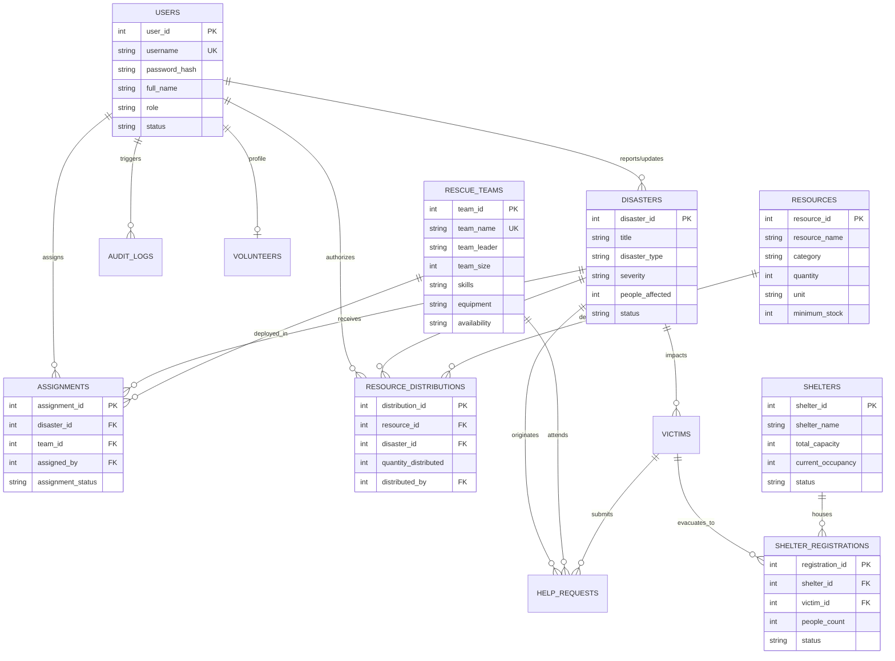

# Disaster Management and Emergency Response System
### *With Priority-Based Rescue Allocation and Relief Resource Tracking*

[](https://www.oracle.com/java/)
[](https://www.mysql.com/)
[](https://maven.apache.org/)
[](https://www.formdev.com/flatlaf/)

---

## 1. Project Overview

The **Disaster Management and Emergency Response System** is a desktop command-and-control software engineered for a second-year engineering college project. It provides emergency coordinators, rescue officers, and volunteer organizations with a unified platform to:
- Register and monitor multi-hazard disaster incidents (Floods, Earthquakes, Fires, Cyclones, Landslides).
- Execute **priority-based rescue team allocation** matching team skills, equipment, and availability to incident demands.
- Triage victims and process emergency distress calls / help requests.
- Track relief supplies across warehouses with **ACID transaction guarantees**, preventing negative inventory and alerting on low stock.
- Manage safe emergency shelters, tracking live occupancy and preventing overcapacity.
- Generate aggregate analytical reports and export datasets to CSV.

The application serves as a concrete demonstration of **Java Object-Oriented Programming (OOP)** and **Relational Database Management System (DBMS)** principles.

---

## 2. Technology Stack

| Layer | Technology | Description |
| :--- | :--- | :--- |
| **Language** | Java 17 LTS | Core object-oriented language |
| **GUI Frontend** | Java Swing & FlatLaf 3.4 | Modern, clean, responsive command console UI |
| **Persistence / DBMS**| MySQL Server 8.0+ | 3NF relational schema with foreign key integrity |
| **Connectivity** | JDBC (`mysql-connector-j`) | Type-safe SQL execution and transaction isolation |
| **Security** | SHA-256 MessageDigest | Cryptographic password hashing (no plain-text storage) |
| **Build & Dependency**| Apache Maven 3.9+ | Compilation, dependency resolution, executable JAR assembly |
| **IDEs Supported** | VS Code, IntelliJ IDEA, Eclipse | Cross-platform standard Maven directory structure |

---

## 3. Architecture & Directory Structure

The project follows a standard **Model-View-Controller / DAO-Service** tiered architecture:

```text
d:/oops cp/
│
├── config/
│   ├── db.properties                    <-- Active database connection settings
│   └── db.properties.example            <-- Template for other development setups
│
├── database/
│   ├── schema.sql                       <-- 12 Normalized relational MySQL tables
│   ├── sample_data.sql                  <-- Seed dataset with realistic incident scenarios
│   └── queries.sql                      <-- Joins, aggregates, subqueries & transactions
│
├── src/
│   ├── main/
│   │   ├── java/com/disastermanagement/
│   │   │   ├── app/
│   │   │   │   └── Main.java            <-- Application entrypoint & Look-and-Feel loader
│   │   │   ├── model/                   <-- Domain Entities & OOP Hierarchy
│   │   │   │   ├── Assignable.java      <-- Interface for assignable entities
│   │   │   │   ├── Reportable.java      <-- Interface for report exportable entities
│   │   │   │   ├── User.java            <-- Abstract base class
│   │   │   │   ├── Admin.java           <-- Concrete User subclass
│   │   │   │   ├── RescueOfficer.java   <-- Concrete User subclass
│   │   │   │   ├── Volunteer.java       <-- Concrete User subclass
│   │   │   │   ├── Disaster.java        <-- Incident model with severity rankings
│   │   │   │   ├── RescueTeam.java      <-- Taskforce model with skills & equipment
│   │   │   │   ├── Assignment.java      <-- Deployment tracking model
│   │   │   │   ├── Victim.java          <-- Affected person / family group model
│   │   │   │   ├── HelpRequest.java     <-- Distress call triage model
│   │   │   │   ├── Resource.java        <-- Relief supply item model
│   │   │   │   ├── ResourceDistribution.java <-- Shipment audit model
│   │   │   │   ├── Shelter.java         <-- Evacuation facility model
│   │   │   │   ├── ShelterRegistration.java  <-- Evacuee check-in record
│   │   │   │   └── AuditLog.java        <-- System audit trail record
│   │   │   ├── dao/                     <-- Data Access Objects (Prepared SQL & Transactions)
│   │   │   │   ├── UserDAO.java
│   │   │   │   ├── DisasterDAO.java
│   │   │   │   ├── RescueTeamDAO.java
│   │   │   │   ├── AssignmentDAO.java
│   │   │   │   ├── VictimDAO.java
│   │   │   │   ├── HelpRequestDAO.java
│   │   │   │   ├── ResourceDAO.java
│   │   │   │   ├── ShelterDAO.java
│   │   │   │   └── AuditLogDAO.java
│   │   │   ├── service/                 <-- Business Logic Layer
│   │   │   │   ├── AuthenticationService.java
│   │   │   │   ├── DisasterService.java
│   │   │   │   ├── RescueAllocationService.java <-- Priority Allocation Engine
│   │   │   │   ├── ResourceService.java
│   │   │   │   ├── HelpRequestService.java
│   │   │   │   ├── ShelterService.java
│   │   │   │   └── ReportService.java
│   │   │   ├── database/
│   │   │   │   └── DatabaseConnection.java <-- Singleton connection manager
│   │   │   ├── exception/               <-- Custom Business & DB Exceptions
│   │   │   │   ├── DatabaseException.java
│   │   │   │   ├── InsufficientResourceException.java
│   │   │   │   ├── InvalidAssignmentException.java
│   │   │   │   ├── CapacityExceededException.java
│   │   │   │   ├── AuthenticationException.java
│   │   │   │   └── ValidationException.java
│   │   │   ├── util/
│   │   │   │   ├── PasswordUtil.java    <-- SHA-256 Hex security hashing
│   │   │   │   ├── ValidationUtil.java  <-- Input validation guards
│   │   │   │   ├── UITheme.java         <-- Palette styling & modern components
│   │   │   │   └── CSVExporter.java     <-- Tabular CSV export utility
│   │   │   └── ui/                      <-- Java Swing Presentation Layer
│   │   │       ├── LoginFrame.java      <-- Secure sign-in dialog
│   │   │       ├── DashboardFrame.java  <-- Master sidebar navigation console
│   │   │       ├── DashboardOverviewPanel.java <-- Summary KPI cards & alerts
│   │   │       ├── DisasterPanel.java   <-- Incident management & filters
│   │   │       ├── RescueTeamPanel.java <-- Roster & gear management
│   │   │       ├── AssignmentPanel.java <-- Rule-based allocation wizard
│   │   │       ├── VictimPanel.java     <-- Evacuee registry & help requests
│   │   │       ├── ResourcePanel.java   <-- Relief inventory & distribution
│   │   │       ├── ShelterPanel.java    <-- Shelter capacity & check-in
│   │   │       ├── ReportsPanel.java    <-- Relational reports & CSV export
│   │   │       └── AuditTrailPanel.java <-- Security & operational log
│   │   └── resources/
│   │       └── db.properties            <-- Classpath fallback properties
│   └── test/
│       └── java/com/disastermanagement/
│           ├── ModelAndOOPTest.java     <-- Tests inheritance, polymorphism, encapsulation
│           └── RescueAllocationRuleTest.java <-- Tests priority allocation rules
└── pom.xml                              <-- Maven project build descriptor
```

---

## 4. Database Design & Entity Relationship Diagram

The database named `disaster_management_db` is normalized to Third Normal Form (3NF).

### Mermaid Entity-Relationship (ER) Diagram



---

## 5. Java Object-Oriented Programming (OOP) Demonstration

| OOP Principle | Implementation in Code |
| :--- | :--- |
| **Encapsulation** | All entities (e.g. [`User`](file:///d:/oops%20cp/src/main/java/com/disastermanagement/model/User.java), [`Disaster`](file:///d:/oops%20cp/src/main/java/com/disastermanagement/model/Disaster.java), [`Shelter`](file:///d:/oops%20cp/src/main/java/com/disastermanagement/model/Shelter.java)) declare data members as `private`. Access and invariant logic are strictly mediated through public getters and setters (e.g., `getAvailableCapacity()`, `hasSpaceFor(count)`). |
| **Inheritance** | Base abstract class [`User`](file:///d:/oops%20cp/src/main/java/com/disastermanagement/model/User.java) is inherited by specialized subclasses [`Admin`](file:///d:/oops%20cp/src/main/java/com/disastermanagement/model/Admin.java), [`RescueOfficer`](file:///d:/oops%20cp/src/main/java/com/disastermanagement/model/RescueOfficer.java), and [`Volunteer`](file:///d:/oops%20cp/src/main/java/com/disastermanagement/model/Volunteer.java), reusing core fields while extending role-specific state. |
| **Abstraction** | [`User`](file:///d:/oops%20cp/src/main/java/com/disastermanagement/model/User.java) defines abstract contract methods `public abstract boolean hasAdminPrivileges();` and `public abstract String getRoleDescription();`. |
| **Polymorphism** | Overridden methods in subclasses execute dynamically based on the runtime instance: `Admin` returns `true` for `hasAdminPrivileges()`, while `RescueOfficer` and `Volunteer` return `false`. UI access rendering dynamically changes without `instanceof` hardcoding. |
| **Interfaces** | [`Assignable`](file:///d:/oops%20cp/src/main/java/com/disastermanagement/model/Assignable.java) abstracts assignable field resources; [`Reportable`](file:///d:/oops%20cp/src/main/java/com/disastermanagement/model/Reportable.java) defines `getReportHeaders()` and `getReportRowData()` implemented across multiple unrelated domain models. |
| **Custom Exceptions** | Explicit domain exceptions model business invariants: [`InsufficientResourceException`](file:///d:/oops%20cp/src/main/java/com/disastermanagement/exception/InsufficientResourceException.java), [`CapacityExceededException`](file:///d:/oops%20cp/src/main/java/com/disastermanagement/exception/CapacityExceededException.java), and [`InvalidAssignmentException`](file:///d:/oops%20cp/src/main/java/com/disastermanagement/exception/InvalidAssignmentException.java). |

---

## 6. DBMS Concepts Demonstrated

1. **Prepared Statements & SQL Injection Prevention**:
   Every query in the DAO layer utilizes `PreparedStatement` with typed parameter binding (`?`).
2. **ACID Transactions (Atomicity & Consistency)**:
   - **Relief Resource Distribution**: Decrementing resource stock and recording distribution history are bound in an atomic `conn.setAutoCommit(false)` transaction. If available stock is less than requested, an `InsufficientResourceException` is thrown, triggering `conn.rollback()` so stock is never negative.
   - **Rescue Allocation**: Verifies team availability, creates assignment record, updates team status to `Busy`, and updates incident status to `Response in Progress` atomically.
   - **Shelter Check-In**: Verifies `current_occupancy + count <= total_capacity`, increments occupancy, updates facility status to `Full` if capacity reached, and records registration in a single transaction.
3. **Complex Relational Joins**:
   - Multi-table inner joins across 4 tables (`assignments`, `disasters`, `rescue_teams`, `users`).
   - Left outer joins showing unassigned teams or unsupplied disasters.
4. **Aggregate Queries with GROUP BY & HAVING**:
   - Total supplies distributed and shipment count grouped by disaster, filtered with `HAVING COUNT(rd.distribution_id) >= 1`.
   - Shelter occupancy utilization percentages calculated with SQL mathematical functions.
5. **Correlated Subqueries**:
   - Identifying resources below category average stock.
   - Filtering critical incidents with `NOT EXISTS (SELECT 1 FROM assignments ...)`.

---

## 7. Priority-Based Rescue Allocation Engine

The allocation service ([`RescueAllocationService`](file:///d:/oops%20cp/src/main/java/com/disastermanagement/service/RescueAllocationService.java)) implements a rule-based algorithm:

1. **Incident Prioritization**: Incidents are prioritized by severity:
   $$\text{Critical (4)} > \text{High (3)} > \text{Medium (2)} > \text{Low (1)}$$
2. **Availability Verification**: If team availability is `Busy` or `Off-Duty`, it is flagged `INELIGIBLE` with 0 points.
3. **Skill & Equipment Matching**:
   - **Flood**: Requires aquatic/swiftwater skills and rafts/boats equipment (+70 pts).
   - **Fire**: Requires firefighting/hazmat skills and breathing apparatus (+70 pts).
   - **Earthquake**: Requires trench/canine/structural SAR and acoustic detectors (+70 pts).
   - **Landslide**: Requires terrain SAR, winch systems, and debris clearing (+70 pts).
   - **Cyclone**: Requires mass evacuation and high-water vehicles (+70 pts).
4. **Scoring & Rationale Generation**: Returns an `EligibilityAssessment` containing a numeric match score and a human-readable explanation of why the team is eligible or ineligible.
5. **Confirmation Dialog**: Presents the full rule rationale before committing the dispatch to the database.

---

## 8. Setup and Installation Instructions

### Prerequisites
1. **Java JDK 17+** installed.
2. **MySQL Server 8.0+** running locally on port `3306`.
3. **Apache Maven 3.8+** installed.

### Step 1: Set Up MySQL Database
Open your MySQL client (Command Line, MySQL Workbench, or phpMyAdmin) and run:

```sql
SOURCE d:/oops cp/database/schema.sql;
SOURCE d:/oops cp/database/sample_data.sql;
```

Or execute from PowerShell / Terminal:
```powershell
mysql -u root -p < "d:/oops cp/database/schema.sql"
mysql -u root -p < "d:/oops cp/database/sample_data.sql"
```

### Step 2: Configure Database Credentials
Open [`config/db.properties`](file:///d:/oops%20cp/config/db.properties) and ensure username and password match your MySQL credentials:
```properties
db.host=localhost
db.port=3306
db.database=disaster_management_db
db.username=root
db.password=your_mysql_password
```

---

## 9. Compilation and Running

### Using Maven (Command Line)
1. **Run Unit Tests**:
   ```bash
   mvn clean test
   ```
2. **Run Application**:
   ```bash
   mvn exec:java
   ```
3. **Package into Standalone Executable Fat JAR**:
   ```bash
   mvn clean package
   ```
   Run the generated JAR:
   ```bash
   java -jar target/disaster-management-system-1.0.0-jar-with-dependencies.jar
   ```

### Running in IDEs
- **IntelliJ IDEA**: Open `d:/oops cp` as a Maven project. Right-click [`Main.java`](file:///d:/oops%20cp/src/main/java/com/disastermanagement/app/Main.java) and select **Run 'Main'**.
- **VS Code**: Open folder in VS Code with the *Extension Pack for Java*. Click **Run** above `public static void main(String[] args)`.
- **Eclipse**: File -> Import -> Existing Maven Projects -> Select `d:/oops cp`. Right-click `Main.java` -> Run As -> Java Application.

---

## 10. Default User Accounts (Demonstration Credentials)

All passwords are cryptographically hashed using **SHA-256**:

| Role | Username | Password | Features Accessible |
| :--- | :--- | :--- | :--- |
| **Administrator** | `admin` | `admin123` | Full system access: Incidents, Teams, Allocation, Victims, Resources, Shelters, Reports, Audit Trail |
| **Rescue Officer** | `officer_sarah` | `rescue123` | Operational access: Incidents, Teams, Priority Allocation, Help Requests, Reports |
| **Volunteer** | `volunteer_emily`| `volunteer123`| Field access: View Incidents, Register Victims, Relief Resources, Shelter Logistics |

> *Tip: The Login screen includes one-click demo sign-in buttons for seamless examiner evaluation.*

---

## 11. Demonstration Workflow & Test Checklist

- [x] **Authentication**: Log in as `admin` / `admin123`. Verify successful login and audit log record. Test with invalid password to verify error message.
- [x] **Disaster Incident Registration**: Navigate to *Disaster Incidents*, click *+ Register New Incident*. Fill form, set severity to `Critical`. Observe immediate KPI card update on Dashboard.
- [x] **Priority Rescue Allocation**: Navigate to *Priority Allocation*. Select the Critical incident. Click *⚡ Evaluate Teams*. Review match scores and the rule-based explanation. Finalize dispatch and verify the team's availability transitions to `Busy`.
- [x] **Prevent Duplicate Assignment**: Attempt to allocate the same `Busy` team to another incident. Verify that the rule engine flags the team as `INELIGIBLE` and blocks assignment.
- [x] **Victim Help Request**: In *Victims & Help Requests*, register an affected family. Generate an emergency help request. Update status to `Assigned` with a dispatched team.
- [x] **Relief Inventory Transaction**: In *Relief Inventory*, note stock of First Aid Kits. Distribute 25 units to an incident. Verify stock decreases and shipment appears in the distribution log. Attempt to distribute 100,000 units to demonstrate **transaction rollback and negative inventory prevention**.
- [x] **Shelter Overcapacity Prevention**: In *Emergency Shelters*, choose a shelter near capacity. Attempt to check in a group exceeding available space. Verify that `CapacityExceededException` blocks the check-in.
- [x] **Analytical Reports & CSV Export**: In *Analytical Reports*, cycle through the 6 relational queries. Click *Export Report to CSV* and inspect the exported file.
